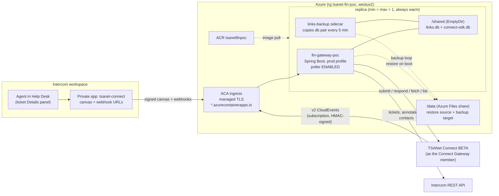
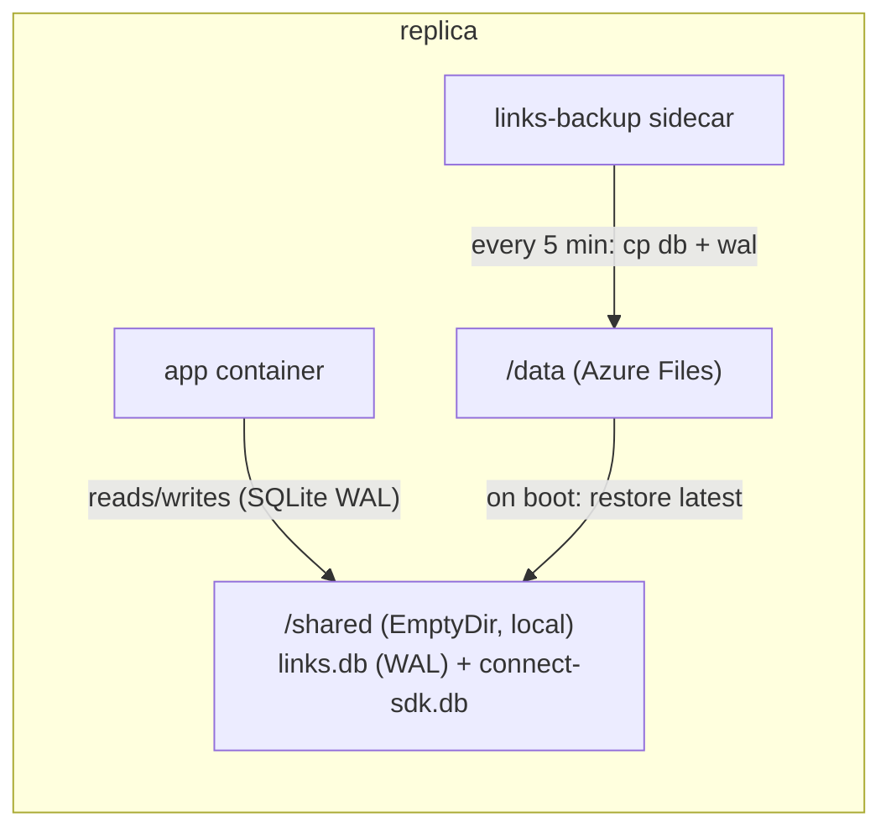
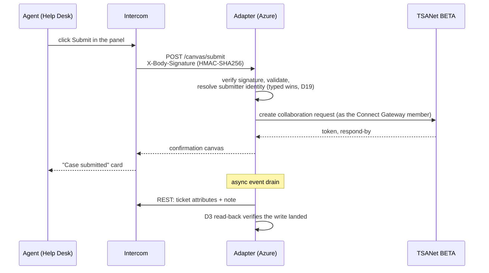
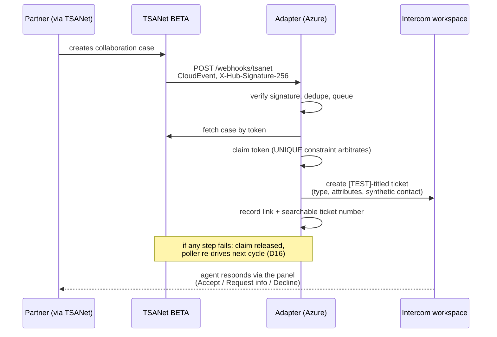
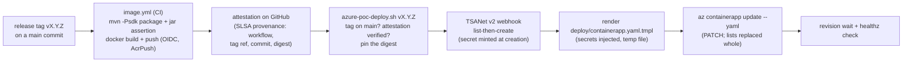

# Azure deployment — architecture and how it works

How the adapter's Azure environment works: the system shape, what happens on each
request in both directions, the storage design, and what separates this test
environment from a production deployment. The runbook is [AZURE_POC.md](AZURE_POC.md);
the exact container spec is `deploy/containerapp.yaml.tmpl`. Everything here is
live-verified (2026-08-08): full outbound submissions from the Inbox, and a full
inbound round trip — partner case → signed CloudEvent → ticket — including an
unplanned real-failure recovery by the reconciliation poller, receipts below.

## System overview



Key properties:

- **Full capability, both directions**: outbound canvas submissions, inbound
  guard-create from TSANet push, the reconciliation poller as the safety net, and
  the response panel (Accept / Request information / Decline) on inbound tickets.
- **Prod profile stays armed** — fake gateways refuse to start, the in-memory link
  store is refused, relative store paths are refused. Only configuration
  distinguishes this environment from a production one.
- **TLS and the hostname are Azure's** — managed ingress certificates on a
  generated `*.azurecontainerapps.io` name; nothing certificate-shaped is managed
  by hand.
- **Always warm** (min = max = 1): the poller actually runs, and canvas responses
  stay inside Intercom's patience with no cold starts.

## Storage: why a sidecar and not a mounted database

Probed live: **SQLite in WAL mode cannot run on an Azure Files SMB mount.** WAL
requires shared-memory mapping the network filesystem cannot provide; the symptom
is `SQLITE_BUSY` at the very first connection, and a clean retry reproduces it. So
the database lives where WAL works and the share holds copies:



- The app container's command restores the latest backup before starting the jar,
  so a replica restart resumes with at most one backup interval (5 minutes) of
  link writes lost.
- The poller cursor lives in the same database file, so it rides the same
  backup/restore path.
- **Hourly snapshots with a 48-hour window (#59):** the sidecar also keeps dated
  copies under `/data/hourly/<UTC yyyymmddHH>/` (links.db, links.db-wal,
  connect-sdk.db — crash-consistent file copies, same semantics as the latest
  copy), pruned as whole directories after 48h, so corruption that overwrites the
  latest copy within one 5-minute cycle is still recoverable to a pre-corruption
  hour. Boot restore uses the LATEST copy only; an hourly restore is manual: stop
  the app (scale to 0 or stop the revision), **delete** `/data/links.db`,
  `/data/links.db-wal`, and `/data/connect-sdk.db`, then copy the chosen snapshot's
  files in, and start the app — the boot restore then picks them up. Delete-first
  is load-bearing, not tidiness: a snapshot may legitimately lack `links.db-wal`
  (post-checkpoint), and copying over the top would leave a newer leftover wal
  sitting beside the snapshot's older db, where SQLite can replay it into the
  restored image on open.
- **SDK-cache retention (#66):** `connect-sdk.db` caches case content (summaries,
  note text, response details, raw webhook payloads). With
  `CONNECTOR_SDK_CACHE_RETENTION` set (blank = off, the default), an in-process
  sweep (`connect-library`'s `CacheRetention`, wired in `connect-gateway`) evicts
  terminal-case rows and their note/response/attachment-config children past the
  window; OPEN cases never age out. `attachment_forward_result` is never evicted —
  it has no API read-back path, so eviction there would be unrecoverable — and a
  child row with no cached parent case is never age-swept either. What eviction
  reaches, and when: the live store immediately, the
  latest `/data` copy within one 5-minute backup cycle, and the hourly snapshots as
  they age out of the 48-hour prune window — so evicted content is fully gone from
  every store at most 48h after the sweep that removed it. Enabling retention on a
  live deployment is the standard deploy-script rerun (env var + restart).
- This is a **recovery point, not a database**: production replaces the whole
  arrangement with a managed database, which the storage layer was explicitly
  designed to make a DataSource change rather than a rewrite.

## Outbound: a canvas click

Every canvas interaction is a signed POST. The signature filter is default-deny
(decisions.md D1): `/healthz` is the only unauthenticated route, and internet scans
against the public hostname show up in the logs as rejected `/` probes — the filter
doing its job.



## Inbound: a partner case becomes a ticket

The push path is primary; the reconciliation poller re-drives anything push
missed. Both entry points refuse terminal cases (#28), and creation is
claim-before-create so duplicate deliveries cannot double-ticket (D14).



**Live receipt for the failure path** (2026-08-08, unplanned): the first real
inbound delivery failed ticket creation on an environment defect (an HTTP 409
contact conflict). The claim released as designed, the next poller cycle held the
cursor (`reconcile_cycle_dirty`), the defect was fixed, and the following cycle
recovered the case (`reconcile_recovered`) and minted the ticket — a clean cycle
after. The self-healing design worked on its first real failure, unstaged.

## Deployment pipeline



One script deploys, idempotently (`scripts/azure-poc-deploy.sh vX.Y.Z`); the same
command is first deploy and update. The TSANet v2 subscription secret exists only
in the creation response, so the script captures it there and carries it into the
app spec.

### Image provenance (#55)

Every image this environment runs traces to a release tag and a commit in this
repository:

1. **Build in CI, never locally.** `.github/workflows/image.yml` builds the exec jar
   and the image on GitHub-hosted runners for every push to `main`, every `v*` tag and
   every manual run, and pushes `fin-gateway:sha-<short>` (plus `fin-gateway:<tag>` on
   tag builds). It signs in to Azure by OIDC federation as the Entra app
   `fin-gateway-ci-push`, which holds AcrPush on the registry and nothing else; its
   federated credential is pinned to the repository's `acr` environment. No stored
   Azure secret and no registry admin credential is involved.
2. **Attest every build.** The same job records a SLSA build provenance attestation
   for the pushed digest (`actions/attest`), signed with a certificate that names the
   workflow, the git ref and the commit. It is stored on GitHub, not in the registry.
3. **Deploy only a verified release.** The deploy script takes one release tag. It
   refuses a tag whose commit is not on `main`, then refuses the registry's
   `fin-gateway:<tag>` image unless `gh attestation verify` confirms it was built by
   `image.yml` in this repository, from `refs/tags/<tag>`, at the tag's commit, on a
   GitHub-hosted runner. Main and manual builds are attested but never deployable.
4. **Pin the digest.** The spec references `fin-gateway@sha256:...`, never a tag, so a
   later push under the same tag cannot change what runs. The app pulls it as the
   user-assigned identity `fin-gateway-poc-pull` (AcrPull only).

Each deploy prints the release, commit, digest and the CI run that built the image.
To trace a running image later, read its digest from the app
(`az containerapp show -g tsanet-fin-poc -n fin-gateway-poc --query 'properties.template.containers[0].image' -o tsv`)
and check it with `gh attestation verify oci://<that image> -R tsanetgit/Fin-Intercom_App --format json`,
which needs registry access (`az acr login -n tsanetfinpoc`).

Not yet covered: the registry admin user stays enabled until the other apps on the
registry stop pulling with it (see the migration step in [AZURE_POC.md](AZURE_POC.md)),
and `v*` tags are not protected from being moved, which is why the deploy script
re-checks the tag's commit against the attestation instead of trusting the tag.

## Configuration

All configuration reaches the container as environment variables; secrets ride ACA
secretrefs. Names are the `application.yml` placeholders verbatim (runtime-proven:
signature verification works in both schemes).

| Env var | Purpose |
|---|---|
| `CONNECTOR_TSANET_MODE=sdk` / `CONNECTOR_INTERCOM_MODE=rest` | real gateways (relaxed binding; the container's entrypoint takes no CLI args) |
| `TSANET_API_URL` / `TSANET_API_USER` / `TSANET_API_PASSWORD` | BETA endpoint + member credential: the Connect Gateway member via Entra client-credentials (`TSANET_API_USER` = client id, `TSANET_API_PASSWORD` = client secret) |
| `TSANET_AUTH_MODE` / `TSANET_ENTRA_TENANT_ID` / `TSANET_ENTRA_AUDIENCE` | `client_credentials` plus the tenant and audience the token is minted against |
| `INTERCOM_ACCESS_TOKEN` | Intercom REST; admin id resolved via `GET /me` at boot |
| `INTERCOM_DEV_CLIENT_SECRET` | canvas + Intercom-webhook signature key |
| `TSANET_WEBHOOK_SECRET` | TSANet CloudEvents signature key (minted by the v2 API at subscription creation) |
| `INTERCOM_COLLABORATION_TICKET_TYPE_ID` / `INTERCOM_RESOLVED_STATE_ID` | per-workspace ids (state ids only enumerable under `Intercom-Version: Unstable`, D17) |
| `CONNECTOR_LINKS_STORE=sqlite` + `CONNECTOR_LINKS_SQLITE_PATH=/shared/links.db` | durable-in-replica store; absolute path satisfies the prod guard |
| `TSANET_SDK_SQLITE_PATH=/shared/connect-sdk.db` | SDK session store, same volume |
| `CONNECTOR_RECONCILE_ENABLED=true` | the poller is on — this environment owns inbound |
| `SPRING_PROFILES_ACTIVE=prod` | baked into the image; all safety guards armed |
| `CONNECTOR_ADMIN_API_SECRET` | admin-plane signature key (Connect_Gateway admin contract v1, D20); unset = every `/admin/*` request 401s, the plane is simply off |
| `CONNECTOR_PUBLIC_BASE_URL` | external base for `/admin/urls`; unset falls back to the request's forwarded/Host headers |

## Test environment vs production

| Concern | This environment | Production |
|---|---|---|
| Purpose | committee demo / testing | member-facing service |
| Link storage | SQLite + 5-minute backup loop (RPO ≈ 5 min) | managed database (a DataSource change by design) |
| Subscription | personal free account | TSANet-controlled subscription |
| Registry auth | user-assigned identity + AcrPull (#55); the admin user stays enabled until the other apps on the registry move off it | managed identity + AcrPull |
| Secrets | injected by the deploy script from `.env` (requires `TSANET_CONNECT_GATEWAY_ENTRA_CLIENT_ID`/`_CLIENT_SECRET` and `TSANET_BETA_ENTRA_TENANT_ID`/`_AUDIENCE`/`_SCOPE`, plus the existing sdk1 API URL var) | key vault references |
| Replicas | 1 (single-writer store + poller cursor) | availability design follows the storage answer |
| Intercom app | private app, dev workspace | pilot: private app on the member workspace; GA: public listing |

## Teardown

```bash
az group delete -n tsanet-fin-poc --yes --no-wait
```

Plus the TSANet v2 webhook subscription (as the Connect Gateway member) so BETA stops delivering.

## Pointers

- Runbook: [AZURE_POC.md](AZURE_POC.md) · spec: `deploy/containerapp.yaml.tmpl` · script: `scripts/azure-poc-deploy.sh`
- Decisions: D1 (signature schemes) · D2 (latency budget) · D3 (verify effects) · D12 (durable links) · D14 (claim-before-create) · D16 (reconciliation) · D17 (per-workspace state ids) · D19 (submitter identity)

## Identity cutover from sdk1 (one-time, 2026-08)

The adapter's TSANet identity moved from sdk1 (password) to the Connect Gateway member
(Entra client-credentials). The deploy script registers the member's own webhook
subscription; sdk1's old subscription keeps delivering to the same callback signed with a
secret the adapter no longer holds, so it must be deregistered once, using sdk1's
credentials (still present in the ops `.env`):

1. Login as sdk1 (`POST /v1/login`), list `GET /v2/webhooks`, note the subscription id for
   this adapter's callback URL.
2. `DELETE /v2/webhooks/{id}` as sdk1.

Until that is done, expect signature-verification failures in the adapter log for every
sdk1-case event; they are noise from the vacated identity, not a fault in the new one.
